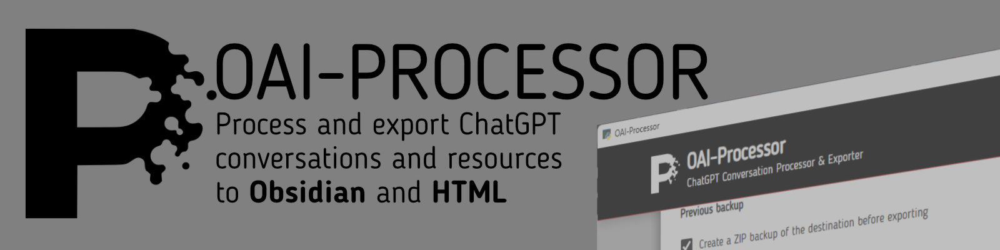

# OAI-Processor
<p align="center">
  
</p>

OAI-Processor is a local application for processing ChatGPT backups and exporting conversations and resources to Obsidian or HTML.

It runs locally on your computer, reads backups created with OAI-Downloader, and provides a web-based interface for selecting projects, processing their contents and configuring exports.

Built by **Corrosion Labs**.

## Features

- Local web interface
- ChatGPT backup analysis and project selection
- Conversation and resource processing
- Obsidian vault export
- HTML export
- Configurable resource conversion and export options
- Reusable export profiles
- Optional backup before exporting
- Local cleanup tools
- English, Spanish and French interface
- Persistent local configuration

## User manual

The OAI-Processor user manual is being prepared.

## Platform status

### Windows

Windows is the current reference platform. Testing of the packaged version is ongoing.

A packaged Windows version will be available from the **GitHub Releases** section.

**Microsoft Edge WebView2 Runtime:** The Windows desktop interface requires WebView2 to be installed and up to date. If the application window does not open or reports a WebView2 error, install or update the runtime using the [official Microsoft download page](https://developer.microsoft.com/en-us/microsoft-edge/webview2/#download).

### Linux / macOS

The Python source is designed to be portable, but Linux and macOS have not yet been officially tested.

Some systems may require additional components for Tkinter or pywebview.

## Run from source

### Requirements

- Python 3
- pip

Clone the repository:

```bash
git clone https://github.com/CorrosionLabs/OAI-Processor.git
cd OAI-Processor
```

Install dependencies:

```bash
python -m pip install -r requirements.txt
```

### Recommended: launcher

Start OAI-Processor using the launcher:

```bash
python launcher.py
```

On the first run, the launcher asks you to select the backup folder and saves that choice in a local settings file. On subsequent runs, it reuses the saved configuration. The launcher also allows you to clear the local configuration without deleting backups or exports.

**Use the launcher for normal use.**

### Direct start (advanced)

You can also start the local interface directly:

```bash
python run_web.py
```

This bypasses the launcher's initial setup. Use it only when the application has already been configured or when you are working directly with the web interface.

## Storage

OAI-Processor reads backup data from the folder selected on the first run. Processed data and generated exports are stored in the backup workspace.

The launcher remembers the selected backup folder using a local configuration file outside the application directory. Clearing that configuration does not remove the backup data, processed files or exports.

## Repository

https://github.com/CorrosionLabs/OAI-Processor

## Security

OAI-Processor works with local backups that may contain private conversations and resources. Review exported files before sharing them or publishing them to a repository.

If you use the optional Obsidian assisted-export connection, keep its API key private.

## Development status

This project is under active development.

The Windows version is currently the reference platform. Linux and macOS compatibility will be verified separately.

## Corrosion Labs

OAI-Processor is developed by **Corrosion Labs**.

## Support

If you find OAI-Processor useful and want to support its development:

<a href='https://ko-fi.com/Y5Y722A4J4' target='_blank'></a>
